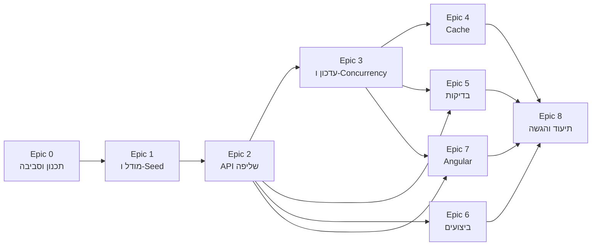

# תוכנית עבודה וחלוקה למשימות

מסמך זה מתאר כיצד אפיון המבדק תורגם לתוכנית עבודה: חלוקה ל-Epics ולמשימות, תוצר מצופה לכל משימה, תלויות, סדר ביצוע והערכת מאמץ. בסוף המסמך מופיעה טבלת מעקב המקשרת כל דרישה במבדק למשימות שמממשות אותה.

**סה"כ הערכת מאמץ:** כ-14 שעות עבודה.

**עקרונות התכנון:**
- סדר הביצוע נקבע לפי תלויות טכניות ולפי משקל התחום בהערכה: בסיס הנתונים וה-Backend קודמים, כי כל השאר נשען עליהם.
- כל משימה מסתיימת בתוצר שניתן להריץ או לבדוק, וב-commit נפרד.
- משימות שאינן כתיבת קוד (תכנון, ביצועים, בדיקות, תיעוד, הרצה) מופיעות כמשימות מלאות עם הערכת זמן.

---

## Epic 0 – תכנון והכנת סביבה

| מזהה | משימה | מה נדרש | תוצר מצופה | תלוי ב- | מאמץ |
|---|---|---|---|---|---|
| T0.1 | ניתוח אפיון ותכנון עבודה | פירוק הדרישות ל-Epics ולמשימות, קביעת סדר ותלויות | מסמך זה | – | 0.5 ש' |
| T0.2 | הקמת Repo ומבנה פתרון | Solution של .NET 8, פרויקט בדיקות, פרויקט Angular, תיקיית docs | מבנה תיקיות מוסכם, build עובר | T0.1 | 0.5 ש' |
| T0.3 | הגדרת סביבת בסיס נתונים | docker-compose ל-SQL Server, connection string לפי סביבה | DB זמין בפקודה אחת | T0.2 | 0.25 ש' |

## Epic 1 – מודל נתונים ונתוני בדיקה

| מזהה | משימה | מה נדרש | תוצר מצופה | תלוי ב- | מאמץ |
|---|---|---|---|---|---|
| T1.1 | תכנון מודל הנתונים | ישות Request, ישות RequestStatusHistory, Enums ל-Status ו-Priority, עמודת RowVersion | מודל מתועד ב-README | T0.2 | 0.25 ש' |
| T1.2 | DbContext, Migration ואינדקסים ראשוניים | קונפיגורציית EF Core, אינדקסים לתרחישי הסינון המרכזיים | Migration שרץ על DB ריק | T1.1, T0.3 | 0.5 ש' |
| T1.3 | יצירת 100,000 רשומות בדיקה | Seeder מבוסס SqlBulkCopy, הרצה חוזרת מוחקת ויוצרת מחדש | 100K רשומות בתוך שניות, פקודה מתועדת | T1.2 | 0.5 ש' |

## Epic 2 – API לשליפת נתונים

| מזהה | משימה | מה נדרש | תוצר מצופה | תלוי ב- | מאמץ |
|---|---|---|---|---|---|
| T2.1 | תשתית API | טיפול גלובלי בשגיאות עם ProblemDetails, Logging, רישום DI | שגיאה לא צפויה מחזירה 500 אחיד ללא חשיפת פרטים | T0.2 | 0.25 ש' |
| T2.2 | חוזה השליפה | DTOs לתוצאה ולפרמטרים, Validation, הגבלת Page Size (מקס' 100) | פרמטר לא תקין מחזיר 400 עם פירוט | T1.2, T2.1 | 0.5 ש' |
| T2.3 | סינון, חיפוש ומיון בצד השרת | סינון משולב (Status, Priority, Organization, AssignedTo, טווח תאריכים), חיפוש ב-Title וב-OrganizationName, מיון לפי 3 שדות Asc/Desc, CancellationToken | GET /api/requests עם כל הפרמטרים, כל הפעולות מתבצעות ב-SQL | T2.2 | 1 ש' |
| T2.4 | שליפת פנייה בודדת | GET /api/requests/{id} | 200 או 404 | T2.2 | 0.25 ש' |
| T2.5 | Aggregations | כמות פניות לפי סטטוס ולפי עדיפות, בכפוף לאותם פילטרים | GET /api/requests/stats | T2.3 | 0.5 ש' |

## Epic 3 – עדכון סטטוס, תחרותיות והיסטוריה

| מזהה | משימה | מה נדרש | תוצר מצופה | תלוי ב- | מאמץ |
|---|---|---|---|---|---|
| T3.1 | עדכון סטטוס עם Optimistic Concurrency | הגדרת מעברי סטטוס מותרים, בדיקת RowVersion, עדכון UpdatedAt | 200 / 400 / 404 / 409 לפי המקרה | T2.4 | 0.75 ש' |
| T3.2 | Audit והיסטוריית שינויים | רשומת היסטוריה באותה טרנזקציה של העדכון, Endpoint לצפייה | GET /api/requests/{id}/history | T3.1 | 0.5 ש' |
| T3.3 | Bulk Update | עד 100 פניות בבקשה, Partial Success עם תוצאה לכל פנייה | POST /api/requests/bulk-status, התנהגות מתועדת | T3.1, T3.2 | 0.75 ש' |

**מעברי סטטוס מותרים (החלטה ב-T3.1):** New ← InProgress, InProgress ← Waiting / Completed, Waiting ← InProgress. Completed הוא סטטוס סופי.

## Epic 4 – Cache

| מזהה | משימה | מה נדרש | תוצר מצופה | תלוי ב- | מאמץ |
|---|---|---|---|---|---|
| T4.1 | Cache ל-Aggregations | IMemoryCache עם Expiration, Invalidation בכל עדכון סטטוס (בודד ו-Bulk) | נתונים מסכמים מתעדכנים מיד אחרי עדכון, הסבר להתאמה ל-Scale-out | T2.5, T3.3 | 0.5 ש' |

## Epic 5 – בדיקות אוטומטיות

| מזהה | משימה | מה נדרש | תוצר מצופה | תלוי ב- | מאמץ |
|---|---|---|---|---|---|
| T5.1 | תשתית בדיקות | WebApplicationFactory עם DB ייעודי לבדיקות | בדיקה ריקה רצה מול API ו-DB | T2.3 | 0.25 ש' |
| T5.2 | Integration Test לשליפה וסינון | קריאה ל-API ובדיקת תוצאות סינון ודפדוף | בדיקה עוברת | T5.1 | 0.25 ש' |
| T5.3 | בדיקות Validation | Page Size חורג, מעבר סטטוס לא חוקי | 400 מאומת | T5.1, T3.1 | 0.25 ש' |
| T5.4 | בדיקת Concurrency Conflict | שני עדכונים עם אותו RowVersion, אחד מצליח והשני מקבל 409 | בדיקה עוברת | T5.1, T3.1 | 0.25 ש' |

## Epic 6 – ביצועים

| מזהה | משימה | מה נדרש | תוצר מצופה | תלוי ב- | מאמץ |
|---|---|---|---|---|---|
| T6.1 | מדידת ביצועים ואינדקסים | Execution Plan לשתי פעולות מרכזיות (שליפה מסוננת ו-Aggregations), השוואה לפני ואחרי אינדקסים, זיהוי Bottleneck | docs/performance.md עם צילומי מסך או מדדים | T2.5, T1.3 | 0.75 ש' |

## Epic 7 – Angular

| מזהה | משימה | מה נדרש | תוצר מצופה | תלוי ב- | מאמץ |
|---|---|---|---|---|---|
| T7.1 | תשתית Frontend | מודלים, RequestsService, הגדרות סביבה | Service שמחזיר נתונים מה-API | T2.3 | 0.5 ש' |
| T7.2 | רשימת פניות | טבלה, דפדוף, מיון וסינון בצד השרת | רשימה עובדת מול 100K רשומות | T7.1 | 1 ש' |
| T7.3 | חיפוש ומצבי UI | Debounce, ביטול בקשות קודמות (switchMap), Loading / Empty / Error | חיפוש מהיר בלי בקשות מיותרות | T7.2 | 0.5 ש' |
| T7.4 | עדכון סטטוס | שליחת RowVersion, טיפול ב-409 עם הודעה ורענון | Conflict מוצג למשתמש בבירור | T7.2, T3.1 | 0.5 ש' |
| T7.5 | Aggregations והיסטוריה | פאנל נתונים מסכמים, צפייה בהיסטוריית פנייה | שני הרכיבים עובדים | T7.2, T2.5, T3.2 | 0.5 ש' |

## Epic 8 – תיעוד והגשה

| מזהה | משימה | מה נדרש | תוצר מצופה | תלוי ב- | מאמץ |
|---|---|---|---|---|---|
| T8.1 | README | הוראות הרצה, גרסאות, מבנה, DB ואינדקסים, Concurrency, Bulk, Cache, החלטות וחלופות, מגבלה ושיפור | README מלא | כל ה-Epics | 0.75 ש' |
| T8.2 | תיעוד שימוש ב-AI | פירוט החלקים שבהם נעשה שימוש ומה נבדק או שונה ידנית | docs/ai-usage.md | מתעדכן לאורך העבודה | 0.25 ש' |
| T8.3 | בדיקת הרצה מקצה לקצה | Clone נקי, הרצה לפי ה-README בלבד, תיקון פערים | פתרון שרץ אצל הבודקים | T8.1 | 0.5 ש' |

---

## סדר ביצוע ותלויות

Epic 5 (בדיקות) ו-Epic 6 (ביצועים) אינם תלויים זה בזה, ולכן ניתן לבצע אותם בכל סדר לאחר השלמת ה-API.

---

## קשר בין דרישות המבדק למשימות

| סעיף במבדק | משימות |
|---|---|
| מבנה פנייה ו-100K רשומות | T1.1, T1.2, T1.3 |
| 1. שליפת נתונים | T2.1, T2.2, T2.3, T2.4, T2.5 |
| 2. עדכון סטטוס ותחרותיות | T3.1 |
| 3. היסטוריית שינויים | T3.2 |
| 4. פעולת Bulk | T3.3 |
| 5. Angular | T7.1 – T7.5 |
| 6. ביצועים | T1.2, T6.1 |
| 7. Cache | T4.1 |
| 8. בדיקות אוטומטיות | T5.1 – T5.4 |
| 9. תכנון עבודה | T0.1 |
| 10. איכות הקוד | T0.2, T2.1 (ונשמרת לאורך כל המשימות) |
| 11. תיעוד | T8.1, T8.2, T8.3 |

---

## סיכונים ותעדוף

אם יתברר שהזמן אינו מספיק, הקיצוץ ייעשה בעיצוב ה-UI ולא בפונקציונליות הליבה: Concurrency, Validation, ביצועים ובדיקות נשארים מלאים, כי הם אלה שמבטיחים נכונות ואמינות המערכת.
