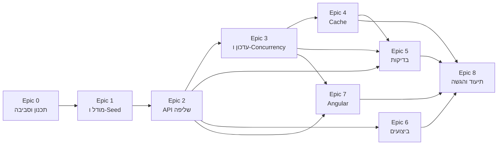

# תוכנית עבודה וחלוקה למשימות

מסמך זה מתאר כיצד אפיון המבדק תורגם לתוכנית עבודה: חלוקה ל-Epics ולמשימות, תוצר מצופה לכל משימה, תלויות, סדר ביצוע והערכת מאמץ. בסוף המסמך מופיעה טבלת מעקב המקשרת כל דרישה במבדק למשימות שמממשות אותה.

**סה"כ הערכת מאמץ:** כ-16 שעות עבודה.

**עקרונות התכנון:**
- סדר הביצוע נקבע לפי תלויות טכניות ולפי משקל התחום בהערכה: בסיס הנתונים וה-Backend קודמים, כי כל השאר נשען עליהם.
- כל משימה מסתיימת בתוצר שניתן להריץ או לבדוק, וכל משימה (או קבוצת משימות קשורות) נשמרת ב-commit נפרד.
- משימות שאינן כתיבת קוד (תכנון, ביצועים, בדיקות, תיעוד, הרצה) מופיעות כמשימות מלאות עם הערכת זמן.

---

## Epic 0 – תכנון והכנת סביבה

| מזהה | משימה | מה נדרש | תוצר מצופה | תלוי ב- | מאמץ |
|---|---|---|---|---|---|
| T0.1 | ניתוח אפיון ותכנון עבודה | פירוק הדרישות ל-Epics ולמשימות, קביעת סדר ותלויות | מסמך זה | – | 0.5 ש' |
| T0.2 | הקמת Repo ומבנה פתרון | Solution של .NET 8 בשלוש שכבות (RequestsApi, RequestsBL, RequestsDAL) ופרויקט בדיקות RequestsApi.Tests, מתודת הרחבה ל-DI בכל שכבה, הפרדת שכבות שנאכפת בקומפילציה (DisableTransitiveProjectReferences), CLAUDE.md עם כללי הפרויקט | מבנה תיקיות מוסכם, build עובר, ה-API לא יכול להשתמש בטיפוסים של ה-DAL | T0.1 | 0.5 ש' |
| T0.3 | הגדרת סביבת בסיס נתונים | SQL Server LocalDB, connection string בשם RequestsDb ב-appsettings.json (ניתן לדריסה במשתנה סביבה), נעילת גרסת ה-SDK ב-global.json, dotnet-ef 8 ככלי מקומי | DB מקומי זמין בלי התקנת שרת | T0.2 | 0.25 ש' |

## Epic 1 – מודל נתונים ונתוני בדיקה

| מזהה | משימה | מה נדרש | תוצר מצופה | תלוי ב- | מאמץ |
|---|---|---|---|---|---|
| T1.1 | תכנון מודל הנתונים | ישות Request, ישות RequestStatusHistory, Enums ל-Status ו-Priority (נשמרים כ-tinyint), עמודת RowVersion | Entities וקונפיגורציית Fluent, מודל מתועד ב-README | T0.2 | 0.25 ש' |
| T1.2 | DbContext, Migration ואינדקסים ראשוניים | קונפיגורציית EF Core, אינדקסים לתרחישי הסינון והמיון המרכזיים, סקריפט סכמה | Migration בשם InitialCreate שרץ על DB ריק, database/01_schema.sql (Idempotent) | T1.1, T0.3 | 0.5 ש' |
| T1.3 | יצירת 100,000 רשומות בדיקה | סקריפט SQL מבוסס סטים (INSERT ... SELECT אחד), נתונים ריאליסטיים ודטרמיניסטיים, הרצה חוזרת מוחקת ויוצרת מחדש | database/02_seed.sql: 100K רשומות בתוך שניות, פקודת sqlcmd מתועדת | T1.2 | 0.5 ש' |

## Epic 2 – API לשליפת נתונים

| מזהה | משימה | מה נדרש | תוצר מצופה | תלוי ב- | מאמץ |
|---|---|---|---|---|---|
| T2.1 | תשתית API | טיפול גלובלי בשגיאות (IExceptionHandler) עם ProblemDetails, Exceptions עסקיים (NotFound, Validation, Conflict), Logging, רישום DI | שגיאה לא צפויה מחזירה 500 אחיד ללא חשיפת פרטים, 400/404/409 לפי סוג השגיאה | T0.2 | 0.25 ש' |
| T2.2 | חוזה השליפה | DTOs לתוצאה ולפרמטרים, Validation, הגבלת Page Size (מקס' 100) | פרמטר לא תקין מחזיר 400 עם פירוט לכל שדה | T1.2, T2.1 | 0.5 ש' |
| T2.3 | סינון, חיפוש ומיון בצד השרת | סינון משולב (Status, Priority, Organization, AssignedTo, טווח תאריכים שבו createdTo כולל את כל היום), חיפוש ב-Title וב-OrganizationName, מיון לפי 6 שדות (createdAt, updatedAt, priority, status, title, organizationName) Asc/Desc עם Id כשובר שוויון, CancellationToken | GET /api/requests עם כל הפרמטרים, כל הפעולות מתבצעות ב-SQL | T2.2 | 1 ש' |
| T2.4 | שליפת פנייה בודדת | GET /api/requests/{id} | 200 או 404 | T2.2 | 0.25 ש' |
| T2.5 | Aggregations | כמות פניות לפי סטטוס ולפי עדיפות על כל הפניות (ללא פילטרים), ב-GROUP BY אחד, כולל ערכים עם 0 | GET /api/requests/stats | T2.3 | 0.5 ש' |

## Epic 3 – עדכון סטטוס, תחרותיות והיסטוריה

| מזהה | משימה | מה נדרש | תוצר מצופה | תלוי ב- | מאמץ |
|---|---|---|---|---|---|
| T3.1 | עדכון סטטוס עם Optimistic Concurrency | הגדרת מעברי סטטוס מותרים, בדיקת RowVersion בבסיס הנתונים (UPDATE ... WHERE RowVersion), עדכון UpdatedAt | PATCH /api/requests/{id}/status: 200 / 400 / 404 / 409 לפי המקרה | T2.4 | 0.75 ש' |
| T3.2 | Audit והיסטוריית שינויים | רשומת היסטוריה באותה טרנזקציה של העדכון, Endpoint לצפייה | GET /api/requests/{id}/history | T3.1 | 0.5 ש' |
| T3.3 | Bulk Update | עד 100 פניות בבקשה, טעינה בשאילתה אחת, כל פריט בטרנזקציה משלו, Partial Success עם תוצאה לכל פנייה (Updated / NotFound / Conflict / InvalidTransition), שימוש חוזר בלוגיקת העדכון הבודד | POST /api/requests/bulk-status, התנהגות מתועדת | T3.1, T3.2 | 0.75 ש' |
| T3.4 | מעברים מותרים ב-DTO | שדה allowedNextStatuses ב-RequestDto, מחושב מאותם כללי מעבר, כדי שה-UI לא ישכפל אותם | כל פנייה מוחזרת עם רשימת הסטטוסים שאליהם מותר לעבור | T3.1 | 0.25 ש' |

**מעברי סטטוס מותרים (החלטה ב-T3.1):** New ← InProgress, InProgress ← Waiting / Completed, Waiting ← InProgress. Completed הוא סטטוס סופי.

## Epic 4 – Cache

| מזהה | משימה | מה נדרש | תוצר מצופה | תלוי ב- | מאמץ |
|---|---|---|---|---|---|
| T4.1 | Cache ל-Aggregations | IMemoryCache עם Absolute Expiration של 60 שניות, Invalidation בכל עדכון סטטוס מוצלח (בודד ו-Bulk) | נתונים מסכמים מתעדכנים מיד אחרי עדכון, docs/cache.md עם הסבר להתאמה ל-Scale-out | T2.5, T3.3 | 0.5 ש' |

## Epic 5 – בדיקות אוטומטיות

| מזהה | משימה | מה נדרש | תוצר מצופה | תלוי ב- | מאמץ |
|---|---|---|---|---|---|
| T5.1 | תשתית בדיקות | WebApplicationFactory מול DB ייעודי ב-LocalDB (RequestsDb_Tests) שנוצר מה-Migrations, סט נתונים קטן וידוע שמאופס לפני כל בדיקה, Fixture משותף | הבדיקות רצות מול API ו-DB אמיתיים, בלי לגעת ב-DB של הפיתוח | T2.3 | 0.25 ש' |
| T5.2 | Integration Test לשליפה וסינון | קריאה ל-API עם פילטרים משולבים ודפדוף | בדיקה עוברת עם תוצאות ו-totalCount מדויקים | T5.1 | 0.25 ש' |
| T5.3 | בדיקות Validation ו-Not Found | Page Size חורג וסטטוס לא קיים בשליפה, עדכון סטטוס למזהה שלא קיים | 400 עם השדה הנכון, 404 מאומת | T5.1, T3.1 | 0.25 ש' |
| T5.4 | בדיקת Concurrency Conflict | שני עדכונים מקבילים עם אותו RowVersion | אחד מצליח, השני מקבל 409, ונכתבת שורת היסטוריה אחת | T5.1, T3.1 | 0.25 ש' |
| T5.5 | בדיקת Bulk | בקשה מעורבת: פריטים תקינים, מזהה שלא קיים, RowVersion ישן ומעבר לא חוקי | תוצאה נכונה לכל פריט, ורק הפריטים התקינים השתנו ב-DB | T5.1, T3.3 | 0.25 ש' |
| T5.6 | בדיקת Cache Invalidation | שליפת stats, עדכון מוצלח ושליפה חוזרת | המספרים מתעדכנים מיד | T5.1, T4.1 | 0.25 ש' |
| T5.7 | Unit Tests לכללי המעבר | [Theory] על מעברים מותרים ואסורים ועל allowedNextStatuses | בדיקות עוברות, docs/tests.md | T3.1, T3.4 | 0.25 ש' |

## Epic 6 – ביצועים

| מזהה | משימה | מה נדרש | תוצר מצופה | תלוי ב- | מאמץ |
|---|---|---|---|---|---|
| T6.1 | מדידת ביצועים ואינדקסים | מדידה עם STATISTICS IO/TIME ו-Execution Plan בפועל לארבע פעולות (שליפה מסוננת, Aggregations, חיפוש טקסט, דף עמוק), השוואה לפני ואחרי אינדקס, בדיקת שימוש באינדקסים (sys.dm_db_index_usage_stats), זיהוי Bottlenecks והצעות שיפור | docs/performance.md עם מדדים, וקובצי .sqlplan בתיקייה docs/performance | T2.5, T1.3 | 1 ש' |
| T6.2 | Rebuild לאינדקסים אחרי ה-Seed | ALTER INDEX ALL REBUILD בסוף 02_seed.sql, כי האינדקסים נשארו מפוצלים אחרי הטעינה | אינדקסים קומפקטיים (0% פיצול) אחרי כל הרצה של ה-Seed | T6.1 | 0.25 ש' |
| T6.3 | אינדקס (Priority, CreatedAt) | החלפת האינדקס על Priority בלבד באינדקס מורכב, לפי המדידות, ומדידה חוזרת | Migration חדש, 01_schema.sql מעודכן, השוואה לפני ואחרי ב-docs/performance.md | T6.1 | 0.25 ש' |

## Epic 7 – Angular

| מזהה | משימה | מה נדרש | תוצר מצופה | תלוי ב- | מאמץ |
|---|---|---|---|---|---|
| T7.1 | תשתית Frontend | אפליקציית Angular עם Standalone Components ו-Angular Material, מודלים התואמים ל-DTOs, RequestsApiService (קריאות HTTP בלבד), הגדרות סביבה, CORS ל-localhost:4200 ב-Development | Service שמחזיר נתונים מה-API | T2.3 | 0.5 ש' |
| T7.2 | רשימת פניות | טבלה, דפדוף, מיון וסינון בצד השרת, רכיבי תצוגה (filters, table) שמדווחים על שינויים ולא קוראים ל-API | רשימה עובדת מול 100K רשומות | T7.1 | 1 ש' |
| T7.3 | חיפוש, מצבי UI ונתונים מסכמים | Debounce על טקסט החיפוש בלבד, ביטול בקשות קודמות (switchMap), Loading / Empty / Error עם Retry, פאנל נתונים מסכמים | חיפוש מהיר בלי בקשות מיותרות, פאנל stats בראש המסך | T7.2, T2.5 | 0.5 ש' |
| T7.4 | עדכון סטטוס | שדה "Your name" (CurrentUserService) שנשלח כ-changedBy, רכיב status-editor שמציג רק את allowedNextStatuses, שליחת RowVersion, השבתה בזמן שמירה, טיפול ב-409 עם הודעה ורענון השורה בלבד, הצגת 400/404, רענון ה-stats אחרי הצלחה | Conflict מוצג למשתמש בבירור, docs/known-limitations.md | T7.2, T3.1, T3.4 | 0.75 ש' |
| T7.5 | היסטוריה | דיאלוג Material עם היסטוריית הפנייה, כולל Loading / Empty / Error | הדיאלוג עובד מכל שורה | T7.2, T3.2 | 0.5 ש' |
| T7.6 | בדיקת עמידה בדרישות | מעבר על הקוד מול כל דרישה, build ובדיקות, וקריאות HTTP אמיתיות כמו של הדפדפן | טבלת עמידה בדרישות עם ראיות מהקוד | T7.1 – T7.5 | 0.25 ש' |

## Epic 8 – תיעוד והגשה

| מזהה | משימה | מה נדרש | תוצר מצופה | תלוי ב- | מאמץ |
|---|---|---|---|---|---|
| T8.1 | README | בעברית: הוראות הרצה, גרסאות, מבנה, API, DB ואינדקסים, Concurrency, Bulk, Cache, בדיקות, החלטות וחלופות, מגבלה ושיפור, קישורים למסמכים המפורטים | README מלא | כל ה-Epics | 0.75 ש' |
| T8.2 | תיעוד שימוש ב-AI | פירוט החלקים שבהם נעשה שימוש ומה נבדק או שונה ידנית | docs/ai-usage.md | מתעדכן לאורך העבודה | 0.25 ש' |
| T8.3 | בדיקת הרצה מקצה לקצה | Clone נקי, הרצה לפי ה-README בלבד, תיקון פערים | פתרון שרץ אצל הבודקים | T8.1 | 0.5 ש' |

---

## סדר ביצוע ותלויות

Epic 5 (בדיקות) ו-Epic 6 (ביצועים) אינם תלויים זה בזה, ולכן ניתן לבצע אותם בכל סדר לאחר השלמת ה-API וה-Cache.

---

## קשר בין דרישות המבדק למשימות

| סעיף במבדק | משימות |
|---|---|
| מבנה פנייה ו-100K רשומות | T1.1, T1.2, T1.3, T6.2 |
| 1. שליפת נתונים | T2.1, T2.2, T2.3, T2.4, T2.5 |
| 2. עדכון סטטוס ותחרותיות | T3.1, T3.4 |
| 3. היסטוריית שינויים | T3.2 |
| 4. פעולת Bulk | T3.3 |
| 5. Angular | T7.1 – T7.6 |
| 6. ביצועים | T1.2, T6.1, T6.2, T6.3 |
| 7. Cache | T4.1 |
| 8. בדיקות אוטומטיות | T5.1 – T5.7 |
| 9. תכנון עבודה | T0.1 |
| 10. איכות הקוד | T0.2, T2.1, T7.6 (ונשמרת לאורך כל המשימות) |
| 11. תיעוד | T8.1, T8.2, T8.3 |

---

## סיכונים ותעדוף

אם יתברר שהזמן אינו מספיק, הקיצוץ ייעשה בעיצוב ה-UI ולא בפונקציונליות הליבה: Concurrency, Validation, ביצועים ובדיקות נשארים מלאים, כי הם אלה שמבטיחים נכונות ואמינות המערכת.
